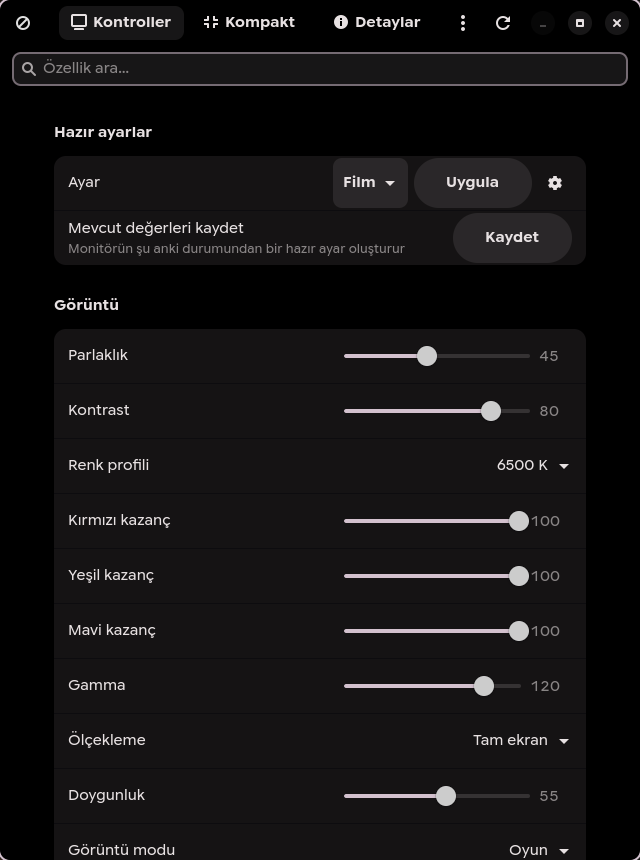

# Nitor

**A modern monitor control panel for Linux.**

Nitor speaks DDC/CI through [`ddcutil`](https://www.ddcutil.com/) and gives you
every standard control your monitor actually reports — brightness, contrast,
colour, gamma, input source, volume, OSD language and more — in a clean
GTK 4 / libadwaita window.

[](https://github.com/Hamzaless/nitor/actions/workflows/ci.yml)
[](LICENSE)
[](pyproject.toml)
[](https://gtk.org/)
[](https://gnome.pages.gitlab.gnome.org/libadwaita/)



## Why another monitor tool?

Most DDC tools are either a raw command line or an old Qt dialog with a wall of
undocumented VCP codes. Nitor aims for the middle ground:

- **Discover, don't guess.** The interface is generated from your monitor's own
  capabilities string. If your display does not support a feature, it is not
  shown.
- **Safe by default.** Undocumented manufacturer-specific VCP codes are
  ignored, and the three destructive "restore defaults" actions ask first.
- **Fast to open.** Values are cached, so the window is usable immediately and
  refreshes in the background.
- **Native.** GTK 4 and libadwaita, follows your system light/dark preference,
  works on Wayland and X11.
- **Small.** No daemon, no kernel module, no vendor driver, no telemetry.

## Features

| Category | Controls |
| --- | --- |
| **Image** | Brightness, contrast, colour preset, red/green/blue gain, gamma, saturation, scaling, display mode |
| **Audio** | Speaker volume, mute / blank screen |
| **Input and power** | Input source (DisplayPort, HDMI-1, HDMI-2, …), power mode |
| **On-screen display** | OSD language |
| **Information** | Horizontal and vertical frequency, panel technology, usage time, application key, controller, firmware, VCP version |
| **Actions** | Restore factory defaults, restore brightness/contrast, restore colour |
| **Presets** | Save the current state and re-apply it later from a dropdown |

Everything above is conditional: Nitor only shows what your monitor reports.

### Quality of life

- Debounced writes — dragging a slider does not flood the DDC bus.
- Protection against monitors that reset brightness and contrast to 100 % when
  the display mode changes.
- **Fast**: every feature is read in a single `ddcutil` call and the I2C bus is
  reused, so a full refresh takes about two seconds.
- Auto-hide: the panel closes when you click somewhere else, so it behaves like a
  HUD. Disable in Settings, with `--no-auto-hide` or `NITOR_AUTO_HIDE=0`.
- Settings dialog for language, auto-hide, slider delay and update checks
  (saved in `~/.config/nitor/settings.json`).
- Update checks: once a day Nitor asks the GitHub releases API and shows a
  banner when a newer version exists. Manual check in the menu, opt-out in
  Settings.
- Diagnostics: copy version, monitor and session details for bug reports.
- A full-window progress overlay shows exactly which setting is being written
  while a preset is applied, and blocks input until it finishes.
- Single-instance window, so a keyboard shortcut always focuses the same panel.
- About dialog and `--version`.

## Requirements

- Linux with a DDC/CI capable monitor connected over DisplayPort or HDMI
- Python 3.10 or newer
- GTK 4 and libadwaita Python bindings
- [`ddcutil`](https://www.ddcutil.com/) 2.x

### Fedora

```bash
sudo dnf install python3-gobject gtk4 libadwaita ddcutil
```

### Ubuntu / Debian

```bash
sudo apt install python3-gi gir1.2-gtk-4.0 gir1.2-adw-1 ddcutil
```

### Arch

```bash
sudo pacman -S python-gobject gtk4 libadwaita ddcutil
```

## Install

### From source (recommended)

```bash
git clone https://github.com/Hamzaless/nitor.git
cd nitor
./install.sh
```

This installs into `~/.local` (override with `PREFIX=/usr/local ./install.sh`),
creates the `nitor` launcher, the desktop entry and the icon.

### With pipx

```bash
pipx install --system-site-packages .
```

`--system-site-packages` lets the app use your distribution's PyGObject, which
is the only reliable way to get GTK bindings on most distributions.

## Usage

```bash
nitor              # open the panel
nitor --lang tr    # force a language
nitor --debug      # verbose logging
nitor --no-auto-hide  # keep the window open when it loses focus
nitor --version
```

The panel is also available as **Nitor** in your application launcher.

### Keyboard shortcut

Nitor does not grab keys globally. Bind it in your desktop.

**Hyprland** (`~/.config/hypr/hyprland.conf`):

```ini
bind = SUPER, M, exec, nitor
windowrulev2 = float, class:^(io.github.hamzaless.Nitor)$
windowrulev2 = size 560 780, class:^(io.github.hamzaless.Nitor)$
windowrulev2 = center, class:^(io.github.hamzaless.Nitor)$
```

**GNOME / KDE**: create a custom shortcut that runs `nitor`.

### Presets

The **Presets** section at the top of the window can save the current brightness,
contrast, colour preset, gamma, saturation and volume as a named preset. Pick a
preset from the dropdown and press **Apply**. Built-in presets were removed on
purpose: a preset should describe *your* monitor, not a guess.

## Languages

| Language | Code | Status |
| --- | --- | --- |
| English | `en` | Complete (source language) |
| Türkçe | `tr` | Complete |

Missing keys fall back to English, so partial translations never break the UI.
Adding a language is a single JSON file — see [CONTRIBUTING.md](CONTRIBUTING.md).

Force a language with `--lang` or `NITOR_LANG`:

```bash
NITOR_LANG=tr nitor
```

## How it works

```text
Nitor (GTK 4) ──> ddcutil ──> /dev/i2c-* ──> DDC/CI ──> monitor
```

Nitor shells out to `ddcutil` for every read and write. It never pokes at I²C
directly, which keeps it portable and avoids reimplementing the protocol.

- On start-up it asks `ddcutil detect` for monitors and `ddcutil capabilities`
  for the feature list.
- Each supported feature is rendered as a slider, a combo box, a read-only row
  or an action button.
- Slider changes are debounced by 300 ms and written on a worker thread so the
  UI never blocks.
- Values are cached in `~/.cache/nitor/cache.json` for instant start-up.

## Troubleshooting

### Nothing happens when I move a slider

Some monitors lock picture settings in certain picture modes. On ASUS displays,
for example, **sRGB** and **Movie** modes lock brightness and contrast. Switch
the monitor to **Games** or **User** mode using its own buttons.

### Nitor found no monitor

- Enable DDC/CI in the monitor's OSD menu.
- Try DisplayPort instead of HDMI (or vice versa).
- On NVIDIA, make sure the proprietary driver is loaded:

  ```bash
  lsmod | grep nvidia
  ```

- Check that `ddcutil detect` sees the display outside Nitor.

### Brightness or contrast jumps to 100 %

Changing the display mode or colour preset makes some monitors reset picture
settings. Nitor saves the previous brightness/contrast and restores them two
seconds after such a change.

### The picture dropped to a low resolution after changing a mode

Some monitors renegotiate the display link when a DDC mode change occurs. This
is a monitor firmware behaviour, not a Nitor bug. Force the mode back, for
example on Hyprland:

```bash
hyprctl keyword monitor "DP-1,1920x1080@165,0x0,1"
```

(With a Lua config, use `hyprctl eval` and `hl.monitor` instead.)

## Development

```bash
git clone https://github.com/Hamzaless/nitor.git
cd nitor
python3 -m venv .venv && source .venv/bin/activate
pip install -e ".[dev]"

pytest -q
ruff check .
python3 -m nitor --debug
```

The test suite mocks `ddcutil`, so it runs without a monitor and in CI.

## Project layout

```text
nitor/
├── nitor/
│   ├── app.py          # CLI entry point
│   ├── ddc.py          # ddcutil wrapper, pure Python
│   ├── i18n.py         # JSON translation layer
│   ├── ui.py           # GTK 4 / libadwaita window
│   └── translations/   # en.json, tr.json
├── data/               # desktop entry, AppStream metadata, icon
├── tests/              # unit tests (no monitor needed)
├── docs/               # screenshots
└── install.sh
```

## License

MIT — see [LICENSE](LICENSE).

---

## Türkçe

**Nitor**, Linux için modern bir monitör kontrol paneli. DDC/CI üzerinden
monitörünün gerçekten desteklediği tüm standart ayarları gösterir: parlaklık,
kontrast, renk, gamma, giriş kaynağı, ses, OSD dili ve daha fazlası.

```bash
sudo dnf install python3-gobject gtk4 libadwaita ddcutil
git clone https://github.com/Hamzaless/nitor.git
cd nitor && ./install.sh
nitor
```

Arayüz Türkçe ve İngilizce. Dil zorlamak için `--lang tr` kullanabilirsin.

> Not: Bilinmeyen üretici kodları (ör. ASUS `0xE2`) bilinçli olarak
> gösterilmez — yanlış VCP değerleri monitör ayarlarını sıfırlayabilir.
